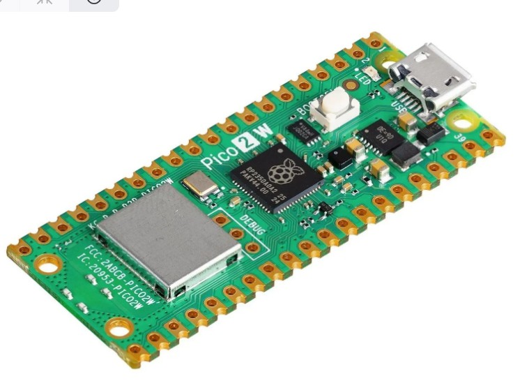
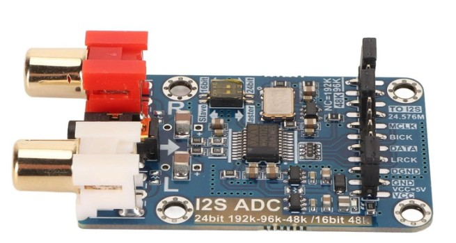
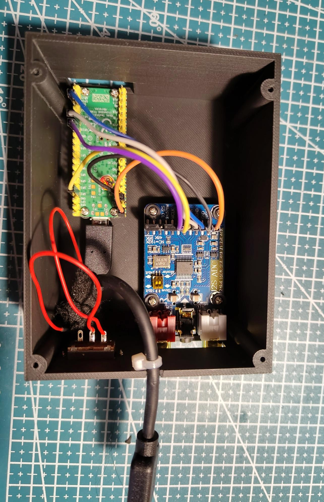
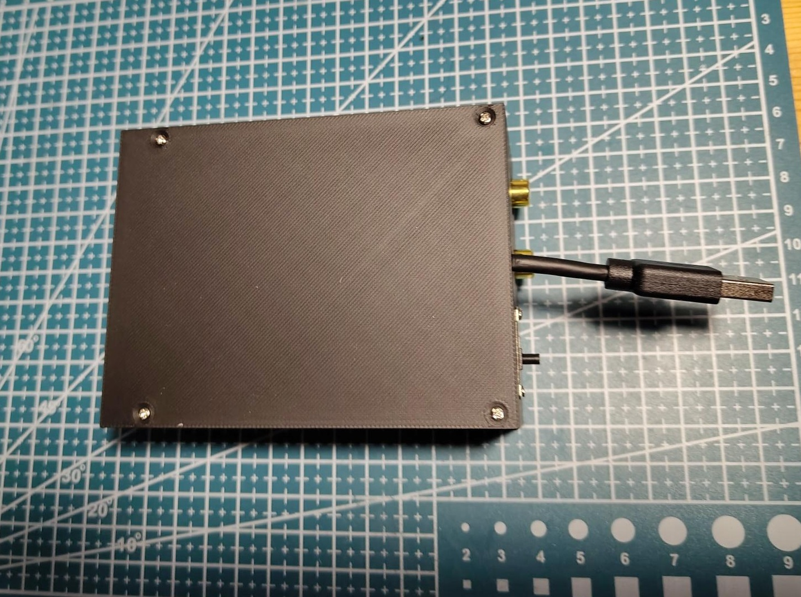
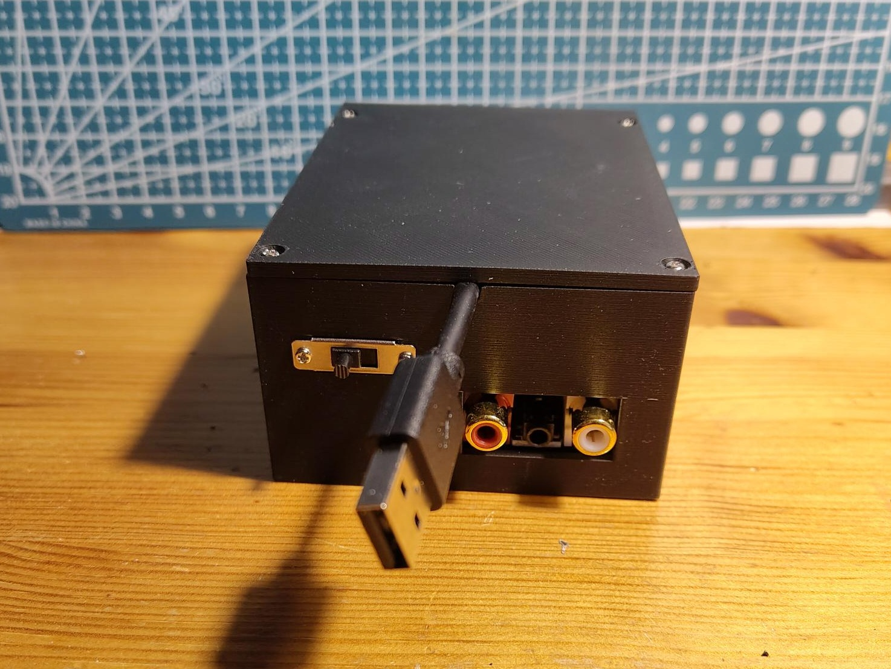

## The hardware

A Raspberry Pi Pico 2 W

A I2S analog to digital converter using a WM8782

## Assembly and wiring

Wiring is done with simple jumper cables.

Wiring is:
WM8782S DATA  -> Pico GP2
WM8782S BICK  -> Pico GP10
WM8782S LRCK  -> Pico GP11
WM8782S DGND  -> Pico GND
WM8782S VCC   -> Pico VBUS / 5 V

The micro-USB cable was cut and the red power line was soldered to the switch which controls now power to the Pico board 

Document the wiring, enclosure, and any lessons learned during assembly.

## Final Form

## Future stuff do to
It buzzes when using the TVs USB ports. Most likely ground loop, hard to fix. Workaround: Use different USB power source.
Case with better pillars to use correct screws. The ADC would need M2.5x5 screws atm. But it works for now.

Have the switch on the other side, where the Bluetooth sender is.

## little docu of what this does

# Making of
  WM8782S I2S input bridge for Pico-ASHA
  =======================================
 
  Purpose:
    Adds an analog TV-audio input to Pico-ASHA using a WM8782S stereo ADC to hook a TV up hearing aids using ASHA
 
  Hardware:
    - Raspberry Pi Pico 2 W
    - WM8782S ADC board
    - ViO T33 6 Li hearing aids
 
  WM8782S configuration:
    - ADC is I2S controller/master
    - Pico is I2S target/slave
    - 96 kHz sample rate
    - 24-bit stereo audio
    - 32-bit I2S slots
    - External/onboard MCLK on the WM8782S board
 
  Wiring:
    WM8782S DATA  -> Pico GP2
    WM8782S BICK  -> Pico GP10
    WM8782S LRCK  -> Pico GP11
    WM8782S DGND  -> Pico GND
    WM8782S VCC   -> Pico VBUS / 5 V
 
  Audio processing:
 
    WM8782S
       |
       | 96 kHz / 24-bit stereo I2S
       v
    Pico PIO
       |
       v
    DMA ping-pong buffers
       |
       v
    i2s_asha_bridge
       |
       | FIR low-pass + decimate by 2
       v
    48 kHz / 16-bit stereo PCM
       |
       v
    asha_audio_encode_1ms_pcm(..., 48)
       |
       | existing Pico-ASHA 48 -> 16 kHz processing
       v
    G.722
       |
       v
    ASHA / Bluetooth LE
       |
       v
    ViO T33 6 Li hearing aids
 
 
  Input selection:
  ----------------
 
  USB audio has priority.
 
  If USB PCM packets are detected:
 
    TV USB -> Pico-ASHA -> hearing aids
 
  If USB PCM disappears for USB_AUDIO_HOLD_US:
 
    TV 3.5 mm -> WM8782S -> I2S bridge -> Pico-ASHA -> hearing aids
 
  I2S DMA continues running while USB is selected, but completed DMA
  buffers are discarded so old analog audio is not replayed when falling
  back to I2S.
 
 
  I2S silence handling:
  ---------------------
 
  The analog path contains silence detection with hysteresis:
 
    I2S_SILENCE_TIMEOUT_MS
        Continuous silence before stopping the ASHA PCM stream.
 
    I2S_START_TIMEOUT_MS
        Continuous detected audio required before restarting the stream.
        This prevents ADC noise from repeatedly triggering ACP/ASP starts.
 
    I2S_SILENCE_THRESHOLD
        Absolute PCM threshold below which a block is considered silent.
 
 
  Important:
  ----------
 
  Do NOT remove the volume update in I2S mode:
 
    asha_audio_set_curr_usb_vol(...)
 
  Pico-ASHA normally updates its ASHA volume state from audio_task().
  Since audio_task() is not used for PCM while I2S is selected, the
  volume update must still be performed separately. Without it, I2S
  audio was tested to be extremely quiet.
 
 
  Known working:
  --------------
 
    - Pico 2 W
    - WM8782S at 96 kHz
    - ViO T33 6 Li hearing aids
    - USB audio -> ASHA
    - Analog 3.5 mm -> WM8782S -> I2S -> ASHA
    - Automatic USB priority / I2S fallback
    - Standalone operation from a USB power supply
    - Automatic ASHA stop/start on analog silence
 
